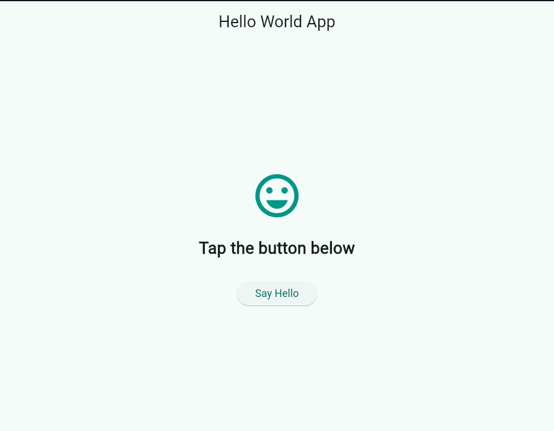
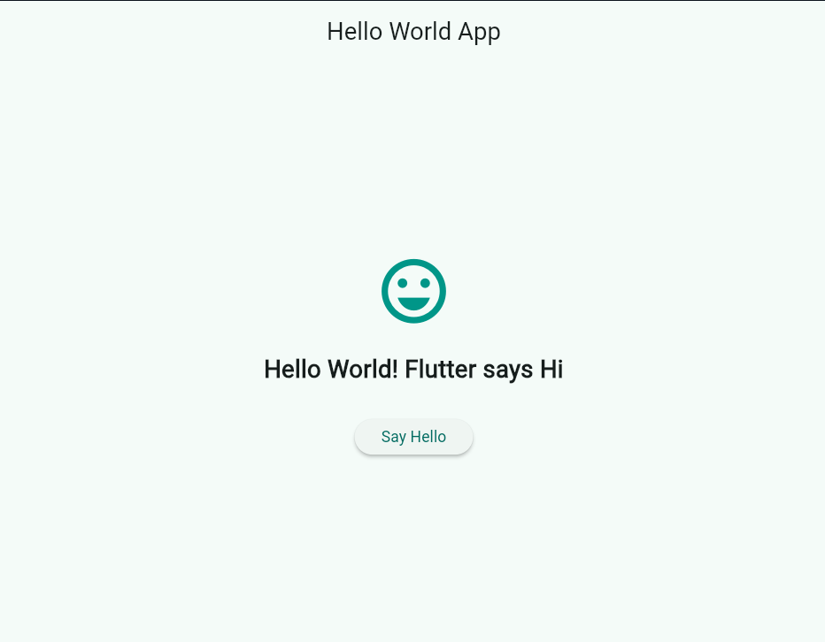

Experiment 2: Hello World App
Aim
To create and run a basic Flutter application that displays a greeting and responds to a button tap.
Description
The app contains:
- An app bar titled Hello World App.
- A smiley icon in the center of the screen.
- A message that initially says Tap the button below.
- A Say Hello button. When tapped, the message changes to Hello World! Flutter says Hi.
Screenshots
1. Initial Screen
The app displays the default message before the button is tapped.

2. Screen After Tapping the Button
After tapping Say Hello, the greeting updates to Hello World! Flutter says Hi.

How to Run
1. Make sure Flutter is installed and configured.
2. Open the Flutter project directory in a terminal.
3. Connect an Android device or start an emulator.
4. Run:
   flutter pub get
   flutter run
Expected Result
The app should first show Tap the button below. Tapping Say Hello should change the message to Hello World! Flutter says Hi.
Conclusion
The experiment demonstrates how to build a simple Flutter interface and update displayed text in response to a button press.
