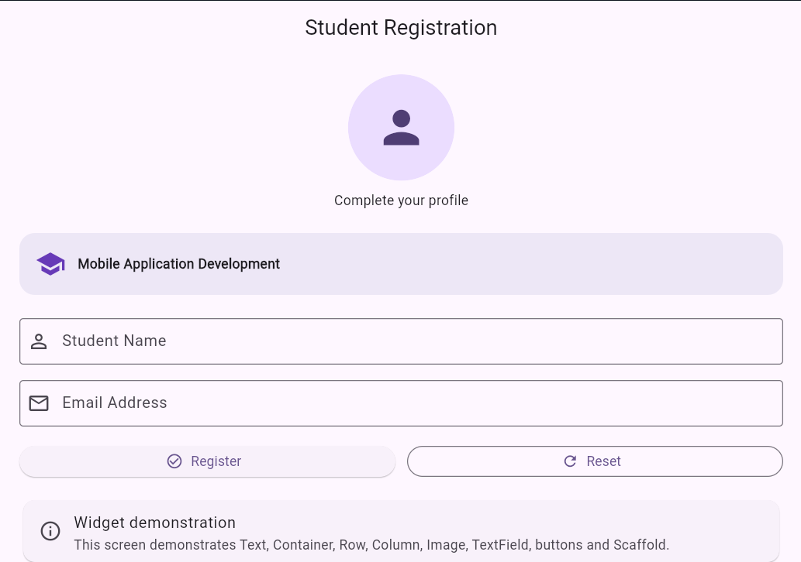
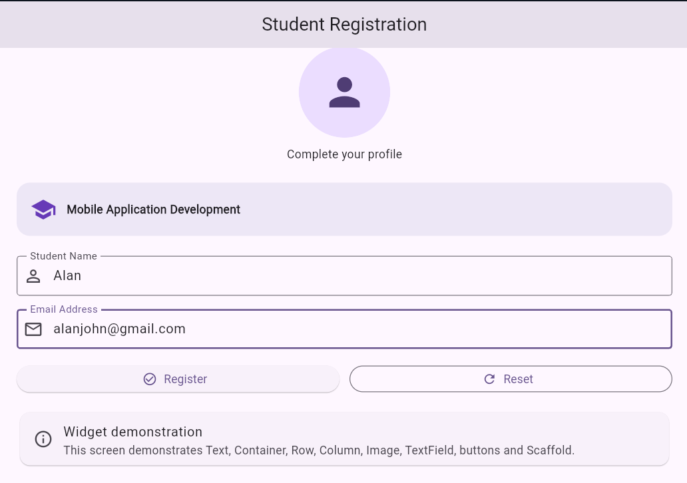

Experiment 3: Student Registration Form
Aim
To design a student registration interface in Flutter using common UI widgets.
Description
The screen is titled Student Registration and contains:
- A profile icon and the text Complete your profile.
- A course information panel displaying Mobile Application Development.
- Text fields for Student Name and Email Address.
- Register and Reset buttons.
- An information panel explaining the widgets demonstrated.
The screenshots show the form first with empty fields and then with sample student details entered.
Screenshots
1. Initial Student Registration Screen
The form is displayed with empty Student Name and Email Address fields.

2. Student Registration Form with Details Entered
The form shows the sample name Alan and email address alanjohn@gmail.com.

Widgets Demonstrated
As stated in the app's information panel, this screen demonstrates Text, Container, Row, Column, Image, TextField, buttons, and Scaffold.
How to Run
1. Ensure Flutter is installed and configured.
2. Open the Flutter project directory in a terminal.
3. Connect an Android device or start an emulator.
4. Run:
   flutter pub get
   flutter run
Expected Result
The app should display the Student Registration form. Users can enter a student name and email address, and the screen provides Register and Reset buttons.
Conclusion
This experiment demonstrates how common Flutter widgets can be combined to create a structured student registration interface.
