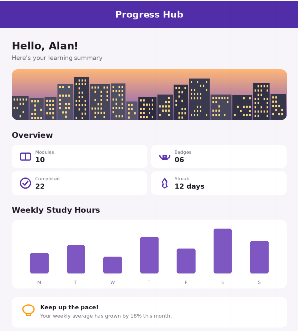

Experiment 6: Progress Hub Dashboard
Aim
To create a learning progress dashboard in Flutter that presents a student's study summary using cards, icons, and a bar chart.
Description
The app is titled Progress Hub and displays a personalized learning summary for Alan.

The dashboard includes:
- A greeting: Hello, Alan!
- A subtitle: Here's your learning summary
- A city skyline illustration.
- An Overview section showing:
  - Modules: 10
  - Badges: 06
  - Completed: 22
  - Streak: 12 days
- A Weekly Study Hours bar chart with bars labelled M, T, W, T, F, S, and S.
- A motivational message: Keep up the pace!
- Supporting text stating that the weekly average has grown by 18% this month.
Screenshot
Progress Hub Dashboard

UI Elements Demonstrated
The screenshot demonstrates a dashboard layout using:
- Text headings and labels
- Icons and an illustration
- Overview cards for progress statistics
- A weekly bar chart
- Rounded containers/cards and spacing
- A motivational information panel
How to Run
1. Ensure Flutter is installed and configured.
2. Open the Flutter project directory in a terminal.
3. Connect an Android device or start an emulator.
4. Run:
   flutter pub get
   flutter run
Expected Result
The app should display the Progress Hub dashboard with the learning summary, progress statistics, weekly study-hours chart, and motivational message.
Conclusion
This experiment demonstrates how a Flutter dashboard can present learning statistics and weekly activity in a clear, visual format.
